# Insurance Pricing using Generalized Linear Models (GLMs)
## Motor Insurance Pricing using the Norauto Dataset

## Overview

This project demonstrates an end-to-end actuarial pricing workflow using the norauto motor insurance dataset from the CASdatasets package.

The objective is to estimate the expected claim cost for each policyholder by modelling:

- Frequency
- Severity
- Pure Premium
- Gross Premium

The project follows a traditional General Insurance pricing framework by comparing multiple statistical models, selecting the most appropriate models using objective performance measures, and interpreting results from an actuarial perspective. Predicted Pure Premiums is matched against actual Claim Amount through visualizations.

The modelling workflow was independently implemented in both R and Python to validate consistency of actuarial calculations across programming environments. 

## Headline Results

|   | R | Python |
|----------|-------------|-------------|
| Frequency model | Poisson GLM (AIC & Dispersion) | Poisson GLM |
| Severity model | Gamma GLM (MSE) | Gamma GLM |
| Test policies | 36,799 | 36,800 |
| Predicted / observed loss (test set) | 1.028 (+2.8%) | 1.004 (+0.4%) |
| Illustrative gross premium per policy record | €1,617 | €1,610 |

## Business Problem
Motor insurers must determine premiums that adequately reflect each policyholder's expected future claims while covering operating expenses and generating a target level of profit.

This project demonstrates how Generalized Linear Models (GLMs) can be used to estimate expected claim costs and convert them into insurance premiums. Gross premiums are estimated by incorporating expense loadings and target profit margins into the expected claim costs.

### Pricing Framework
- Pure Premium represents the expected cost of claims for an individual policyholder.
 
$$
Pure Premium = Frequency * Severity
$$
- Gross Premium is the premium that insurance companies must recover operating expenses and earn an appropriate profit.

$$
Gross Premium = \frac{Pure Premim}{1 - Variable Expense Ratio - Profit Margin}
$$

## Dataset

The Norauto dataset, available through the CASdatasets R package([CASDatasets](https://dutangc.github.io/CASdatasets/index.html)), contains 183,999 observations of automobile insurance policies losses over a one-year period.

| Variable | Description |
|----------|-------------|
| Male | 1 if the policyholder is a male, 0 otherwise |
| Young | 1 if the policyholder age is below 26 years, 0 otherwise |
| DistLimit | The distance limit as stated in the insurance contract: "8000 km", "12000 km", "16000 km", "20000 km", "25000-30000 km", "no limit". |
| GeoRegion | Density of the geographical region (from heaviest to lightest): "High+", "High-", "Medium+", "Medium-", "Low+", "Low-". |
| Expo | Exposure as a fraction of year. |
| NbClaim | claim number |
| ClaimAmount | 0 or the average claim amount if NbClaim > 0. |

## Feature Engineering & Explanatory Data Analysis: Male, Young, DistLimit, GeoRegion
### 1. Feature Engineering: Relevel Factor Variables
DistLimit and GeoRegion are factored with their levels listed below. To improve interpretation and visualisation, both variables were converted into ordered categorical factors based on the descriptions provided by the dataset authors.
This ordering allows trends in claim frequency and severity to be interpreted more intuitively.

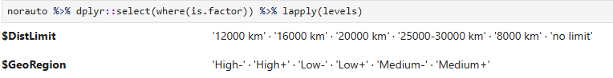

After relevelling, variable DistLimit are in order "8000 km", "12000 km", "16000 km", "20000 km", "25000-30000 km", "no limit". Varibale GeoRegion are in order of "High+", "High-", "Medium+", "Medium-", "Low+", "Low-", which is ordered from heaviest to lightest.

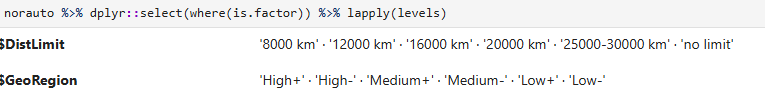

### 2. Data Summary & Visuals
Exploratory analysis was performed to understand relationships between policyholder characteristics and insurance risk.
Summary statistics for Frequency and Severity, and visualizations were produced for:
- Male
- Young
- DistLimit
- GeoRegion

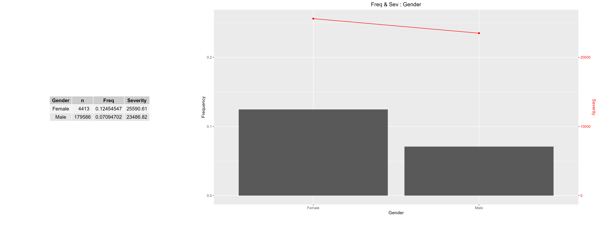

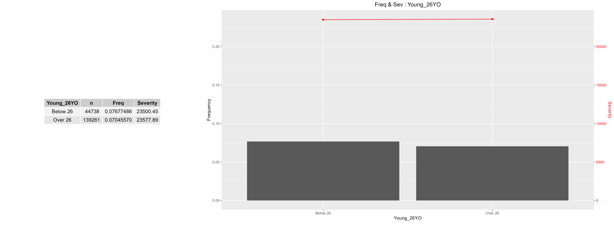

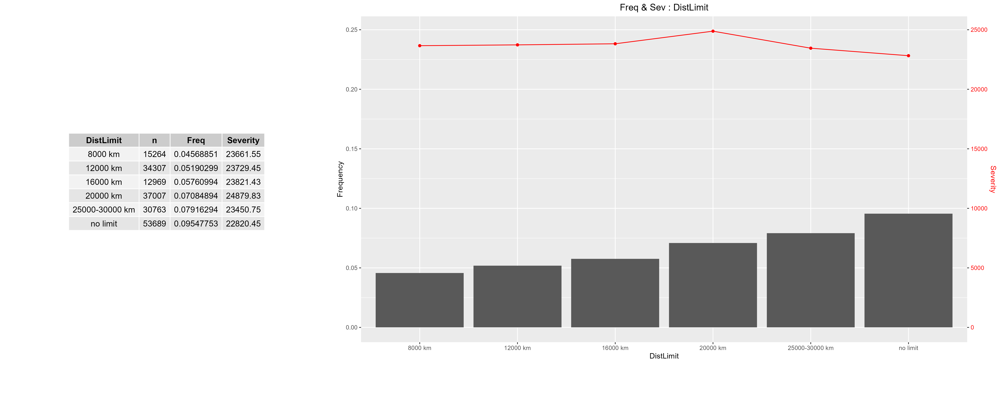

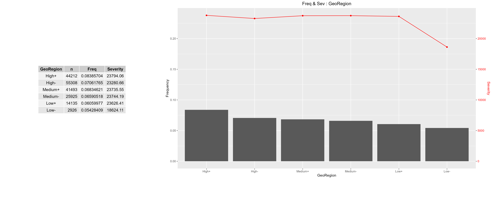

## Train data & Test Data
Before frequency and severity modelling, relevelled data is split into train and test datasets, with 80% for train data, and 20% for test data.
Dimension for train and test datasets are,

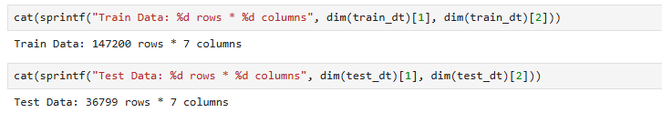

## Frequency Modelling

Claim frequency was modelled using two Generalized Linear Models:

- Poisson Regression
- Negative Binomial Regression

Model performance was compared using:

- Akaike Information Criterion (AIC)
- Dispersion Statistic

The Poisson model produced the lower AIC while maintaining a dispersion statistic close to one, indicating that it provided the most appropriate fit for the training data.

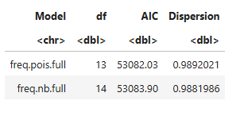

## Severity Modelling
Claim severity was modelled using

- Gamma GLM
- Lognormal GLM

Predictive performance was evaluated using Mean Squared Error (MSE). The Gamma model achieved the lowest MSE and was therefore selected for premium estimation.

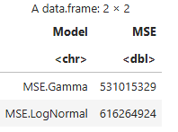

## Pure Premium

The selected models -Poisson for Frequency and Gamma for Severity- were combined to estimate policy-level pure premiums.

Portfolio-level validation produced the following result.

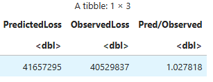

The predicted aggregate pure premium was approximately 2.8% higher than the observed portfolio loss, indicating good agreement between the selected frequency and severity models by R. Model by R over-estimates loss while model by Python under-estimates loss by 0.4%. A gap of this size is consistent with the two languages using different random splits, since claim counts and large losses in a 20% test set vary from split to split.

## Gross Premium

The pure premium represents the expected claim cost only. In practice, insurers must also account for operating expenses, commissions, reinsurance costs, regulatory requirements, and target profit when determining the final premium charged to customers. Gross premium was estimated by applying a permissible loss ratio assumption of 70%, implying that expected claims represent 70% of the premium collected. 

Using the portfolio average pure premium, the illustrative gross premium was calculated as:

$$
Gross Premium = \frac{Pure Premim}{1 - Variable Expense Ratio - Profit Margin}
$$

For the R model, a mean pure premium of €1,132 and a gross premium of €1,617 per test policy.

**R Outputs:**
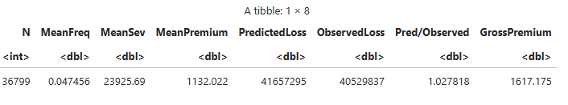

**Python Outputs:**
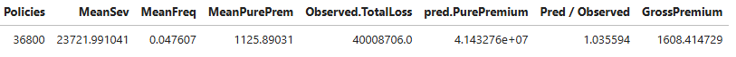

## Results: Predicted Loss vs Actual Claims Amount
### Portfolio Level
| Tool | Policies | Predicted Loss |  Observed Loss | Pred/Obs |
|----------|-------------|-------------|-------------|-------------|
| R | 36,799 | 41.66m | 40.53m | 1.028 |
| Python | 36,800 | 41.46m | 41.29m | 1.004 |

Predicted Pure Premium vs Actual Loss by Gender, Young_26YO, DistLimit and GeoRegion is plotted using R and Python.  

- Gender: R over-predicts pure premium for females, while Python under-predicts. The two gaps point in opposite directions on a group with only about 60 test claims, which is what sampling noise looks like.
- Young_26YO: Both models fit well.
- DistLimit: both models show the upward trend. The misses fall on different bands: R over-predicts 12,000 km and 20,000 km, and under-predicts 16,000 km and 25,000-30,000 km; Python under-predicts 8,000 km and 20,000 km, and over-predicts 16,000km and 25,000-30,000 km.
- GeoRegion: both show the downward trend. R over-predicts High- and Low-, and under-predicts High+ and Medium+; Python over-predicts High- and Medium-, and under-predicts High+, Medium+ and Low-.

**R outputs:**
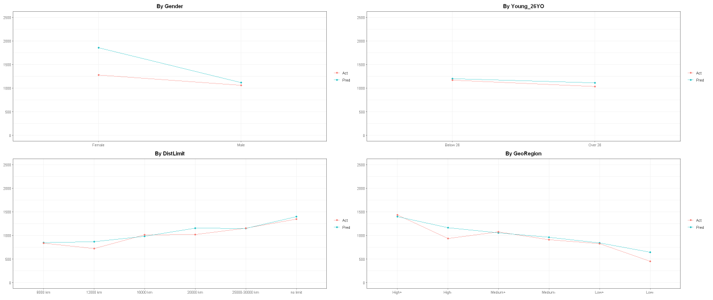

**Python outputs:**
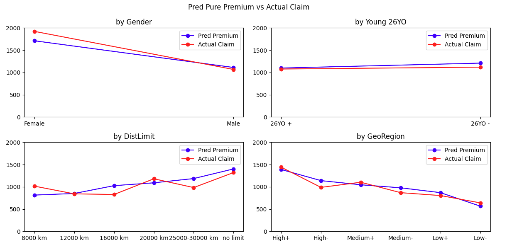

Differences in final premium estimates were caused by different random train/test partitions rather than modelling differences. 

## Limitations

This project is intended as a demonstration of actuarial pricing techniques.

Several simplifications were adopted.
- Fixed expense ratio and profit margin.
- Limited rating variables available in the dataset.
- No continuous variables

Future work could explore more advanced pricing methods such as Tweedie GLMs, Generalized Additive Models (GAMs), or gradient boosting techniques.

## Conclusion

This project demonstrates a complete actuarial pricing workflow from raw policy data through exploratory analysis, frequency modelling, severity modelling and premium estimation.

Independent implementations in Python and R produced consistent modelling results, illustrating both statistical methodology and practical actuarial pricing principles.
